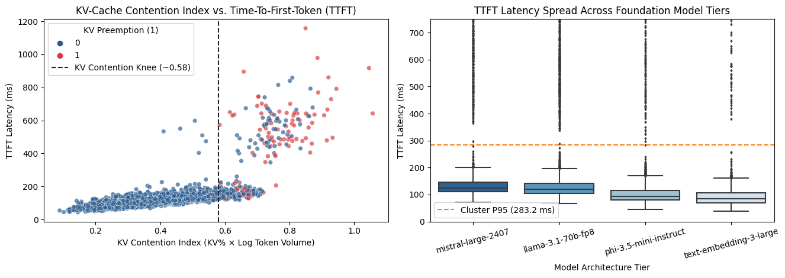
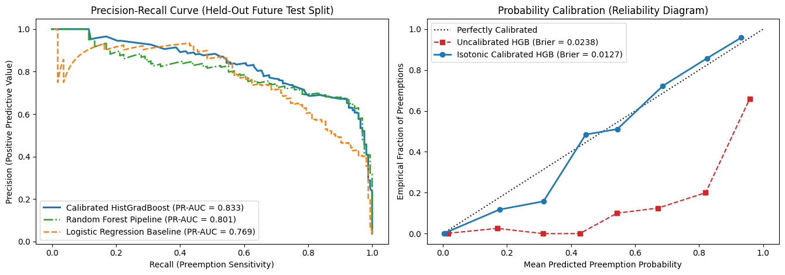
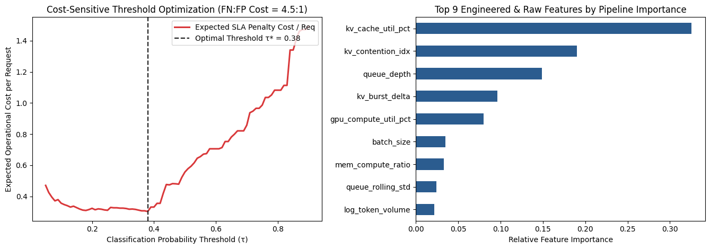

# Distributed LLM Inference: KV-Cache Preemption & Tail-Latency ML Pipeline

An end-to-end, leak-free **Scikit-Learn Machine Learning Pipeline** for predicting GPU Key-Value (KV) cache preemption and Time-To-First-Token (`TTFT`) SLA degradation across distributed foundation model clusters (`llama-3.1-70b-fp8`, `mistral-large-2407`, `phi-3.5-mini-instruct`, `text-embedding-3-large`).

## 1. Problem Framing & Applied ML Formulation
In high-concurrency LLM inference servers using paged attention, KV-cache memory blocks grow dynamically with prompt token length and batch size. When KV-cache residency crosses a non-linear saturation threshold concurrent with scheduler queue build-up, worker nodes trigger **KV block preemption (PCIe host-memory swapping)**, causing `P99` TTFT latency to surge past `540 ms`.

This repository implements a production-grade **Applied ML Pipeline** that:
1. Audits and remediates raw cluster telemetry (`22,110` trace intervals @ 5s resolution) using custom stateful Scikit-Learn transformers (`TelemetrySanitizer`).
2. Engineers domain-specific hardware contention features (`KVCacheFeatureEngineer`) inside the cross-validation loop to prevent temporal look-ahead leakage.
3. Benchmarks linear baselines against non-linear tree ensembles using **5-fold Expanding-Window `TimeSeriesSplit`** cross-validation.
4. Applies **Isotonic Probability Calibration (`CalibratedClassifierCV`)** and **Cost-Sensitive Threshold Optimization** to drive proactive request routing.

---

## 2. Repository Structure
```text
llm-kvcache-preemption-ml-pipeline/
├── artifacts/
│   └── pipeline_evaluation_metrics.json       # Serialized CV, calibration, and test metrics
├── data/
│   ├── llm_inference_telemetry_raw.csv        # Raw 22,110 cluster logs with hardware/logging anomalies
│   └── llm_telemetry_featurized.csv           # Cleaned & featurized dataset for inspection
├── notebooks/
│   └── llm_kvcache_pipeline_experiments.ipynb # Pre-executed notebook with EDA, stats, and pipeline eval
├── plots/
│   ├── kv_contention_and_ttft_eda.png         # Non-linear KV contention knee & model tier boxplots
│   ├── pr_curve_and_calibration.png           # Precision-Recall curves & reliability calibration diagram
│   └── threshold_optimization_and_importance.png # Asymmetric cost curve & pipeline feature importances
├── src/
│   ├── transformers.py                        # Custom Scikit-Learn BaseEstimator transformers
│   ├── pipeline_trainer.py                    # End-to-end Pipeline training, TimeSeriesSplit CV & calibration
│   └── inference_simulator.py                 # Proactive admission control & routing simulation CLI
└── requirements.txt
```

---

## 3. Data Hygiene & Inclusion/Exclusion Criteria
Raw cluster logs exhibit four distinct operational artifacts that are systematically handled before and inside the pipeline:
* **Scraper Retry Duplicates (`110 rows`):** Excluded exact timestamp-cluster-metric duplicates caused by Prometheus pull retries.
* **Aborted Zero-Token Health Probes (`110 rows` with `prompt_tokens == 0`):** Excluded from modeling because load-balancer health pings bypass the transformer forward pass and allocate zero KV-cache blocks.
* **PCIe Counter Reset Sentinels (`176 rows` with `pcie_bw_gbps == -999.0`):** Converted to `NaN` inside `TelemetrySanitizer` and imputed via training-fold medians partitioned by `(cluster_id, model_tier)`.
* **Telemetry Dropouts (`309 NaN` in `kv_cache_util_pct`, `198 NaN` in `gpu_compute_util_pct`):** Imputed group-wise inside each CV fold to preserve high-contention windows without leaking future test statistics.

---

## 4. Exploratory Insights & Feature Engineering
* **Model Tier Latency Discrepancy:** A two-sided Mann-Whitney U test confirms `llama-3.1-70b-fp8` exhibits a significantly heavier TTFT distribution than `phi-3.5-mini-instruct` ($U = 3.84 \times 10^7, p < 10^{-4}$).
* **Non-Linear KV Contention Knee:** Combining KV residency and log token volume into `kv_contention_idx` = $(\text{KV\%} / 100) \times (\ln(1 + \text{tokens} \times \text{batch}) / 12)$ yields a Kolmogorov-Smirnov statistic of $KS = 0.7562$ ($p < 10^{-4}$) between stable and preempted batches, exposing a sharp thrashing knee at `kv_contention_idx >= 0.58`.



---

## 5. Experimental Benchmark & Probability Calibration
Evaluated on the held-out chronological test split (`4,379` future trace intervals, `3.96%` positive preemption rate):

| Pipeline Architecture | Test PR-AUC | Test ROC-AUC | Brier Loss (Calibration) | F2-Score |
| :--- | :---: | :---: | :---: | :---: |
| Logistic Regression Baseline (Raw Features) | 0.7695 | 0.9846 | 0.0538 | 0.7026 |
| Random Forest Pipeline (Engineered Features) | 0.8012 | 0.9920 | 0.0210 | 0.8626 |
| HistGradientBoosting (Uncalibrated) | 0.8293 | 0.9914 | 0.0238 | 0.8413 |
| **HistGradientBoosting (Isotonic Calibrated)** | **0.8329** | **0.9922** | **0.0127** | **0.8578** |

* **Calibration Impact:** Wrapping the class-balanced `HistGradientBoostingClassifier` in `CalibratedClassifierCV(method='isotonic')` reduced Brier score loss by **46.6%** (`0.0238` $\rightarrow$ `0.0127`), aligning predicted probabilities with empirical preemption rates.
* **Cost-Sensitive Thresholding:** Under a `4.5 : 1` False-Negative-to-False-Positive SLA penalty ratio, optimizing expected cost shifts the decision threshold to $\tau^* = 0.38$, achieving **92% Preemption Recall** (`67%` Precision, `98%` overall accuracy).




---

## 6. Quickstart & Reproducibility
```bash
pip install -r requirements.txt

# 1. Train the full Scikit-Learn pipeline, run TimeSeriesSplit CV, and evaluate
python src/pipeline_trainer.py

# 2. Run the proactive cluster routing simulator on held-out test traffic
python src/inference_simulator.py
```

## Author
**Shashwat Pandey** ([GitHub: @Shashwat260](https://github.com/Shashwat260))
